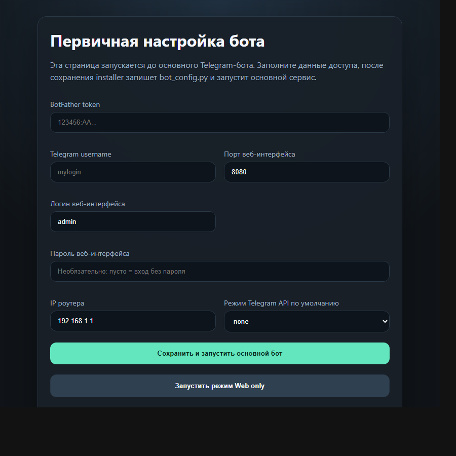
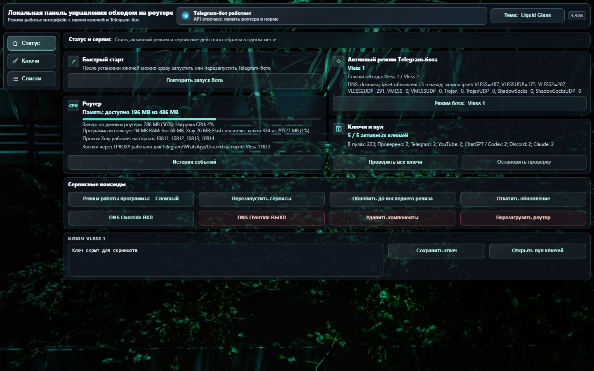
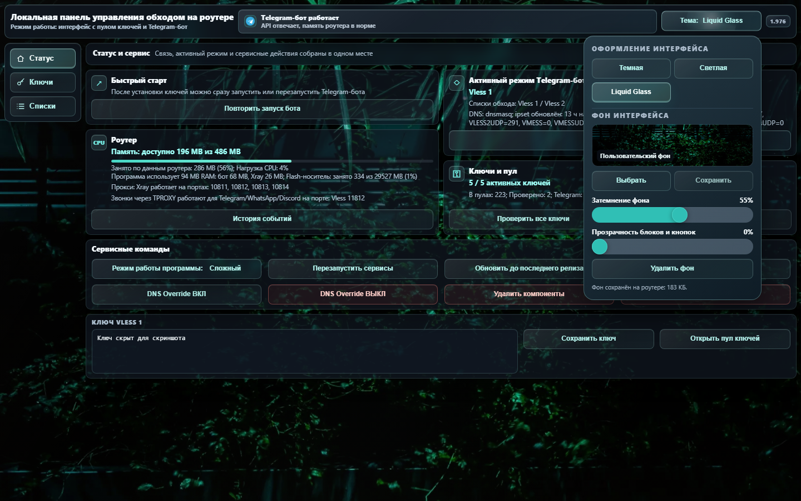
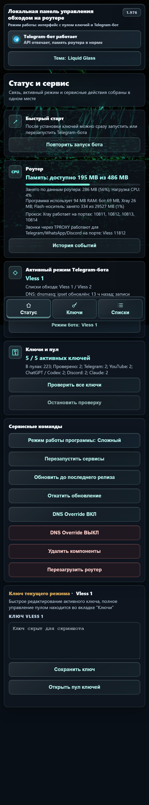
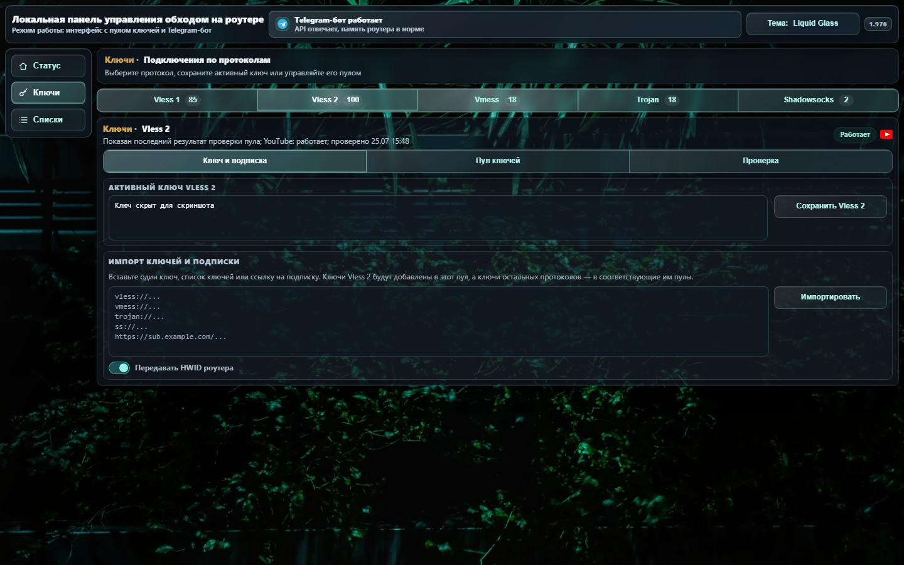
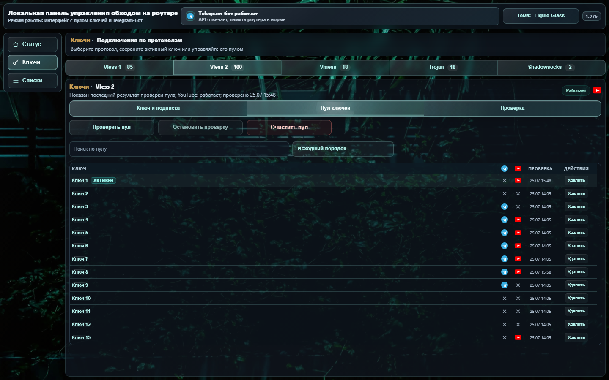
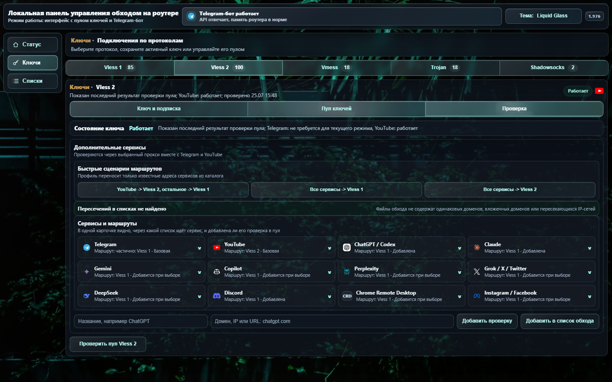
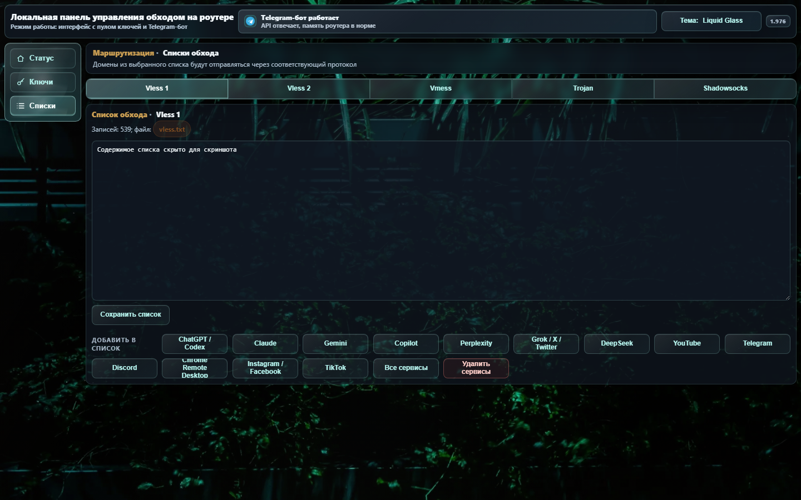

# Использование bypass_keenetic

[Обзор и установка](../README.md) · [История изменений](../CHANGELOG.md)

## Обновление со старых веток

Поддерживается переход на `main` со следующих старых веток:
- `main`;
- `codex/main`;
- `codex/main-v1`;
- `codex/independent-v1`;
- `codex/web-only-v1`;
- `feature/independent-rework`;
- `feature/web-only`;
- `feature/without-telegram-bot`.

В старом Telegram-боте или веб-интерфейсе можно нажать обновление/переустановку из текущей ветки. Старое имя ветки будет вести на новый код `main`, после чего установленная программа уже будет обновляться из `main`.

При обновлении сохраняются:
- `/opt/etc/bot_config.py` или `/opt/etc/bot/bot_config.py`;
- активные ключи;
- пул ключей;
- пользовательские проверки;
- списки обхода;
- выбранный режим работы программы.

## Веб-интерфейс

**Статус**

Показывает состояние роутера, ключей, быстрый старт и сервисные команды. В режимах с ботом дополнительно отображаются Telegram API и активный режим Telegram-бота; в **Web only** эти элементы скрыты.

В блоке роутера DNS-часть показывает текущий режим и состояние `ipset`. Кнопки **DNS Override ВКЛ** и **DNS Override ВЫКЛ** явно переключают между штатным DNS Keenetic через `ndnproxy` и основным DNS через `dnsmasq`: в режиме `dnsmasq` наборы `ipset` наполняются динамически по route-файлам, а в режиме `ndnproxy` домены заранее резолвятся скриптом `/opt/bin/unblock_ipset.sh`.

UDP/443 обрабатывается по содержимому списков обхода: YouTube/QUIC-наборы создаются для того протокола, где сейчас находится YouTube, а Telegram остаётся на своём маршруте даже при совместном списке.

Для мобильных уведомлений Telegram TCP/5222 следует за тем протоколом, в списке которого находится Telegram: Shadowsocks, VMess, VLESS1, VLESS2, Trojan или Hysteria2. Системные каналы push для iOS APNs (TCP/5223) и Android FCM (TCP/5228-5230) проходят напрямую.

Realtime-звонки Telegram, WhatsApp и Discord: программа определяет активных клиентов, временно запоминает связанные UDP-медиа-адреса и отправляет их через TPROXY-порт текущего протокола сервиса.

Если общий IP оказался в другом приоритетном маршруте, Xray распознаёт TCP-домен и выбирает выход из его пользовательского списка. Это действует для любых однозначно назначенных доменов, включая добавленные вручную, при перехвате прозрачными входами Vless 1/2, Vmess и Hysteria2. Выбирается только доступный выход; поддерживаются также выходы Shadowsocks и Trojan. Дубликаты между протоколами и пересечения родительских доменов с поддоменами разных маршрутов сохраняют прежнюю политику входа до разрешения конфликта. Без доступного имени узла (например, при скрытом SNI) остаётся прежнее поведение по IP. Проверки ключей через SOCKS, отдельные цепочки NAT Trojan/Shadowsocks, UDP/QUIC и звонки этим правилом не меняются.

**Ключи**

Позволяет редактировать активный ключ, переключать протоколы, работать с пулом ключей и запускать проверки. В простом режиме пул ключей и расширенные проверки скрыты.

Сортировка «Качество YouTube» оставляет активный ключ первым, затем показывает работающие, нестабильные, непроверенные и нерабочие ключи. Внутри работающей группы выше ключ с большим баллом. Подсказка показывает тот же балл по шкале 0–100: это оценка, не процент. Без замера скорости оценка предварительная и обычно находится в диапазоне 50–75; высокий балл сам по себе не гарантирует воспроизведение в определённом разрешении. После отказа YouTube прежний высокий балл не учитывается. Автоматический выбор ключей использует прежние правила.

**Списки**

Редактирование списков обхода для каждого протокола. Готовые наборы можно добавлять кнопками: Telegram, YouTube, ChatGPT/Codex, Claude, Gemini, Copilot, Perplexity, Grok/X/Twitter, DeepSeek, Discord, Chrome Remote Desktop, Instagram/Facebook, TikTok или все сервисы сразу. Одно нажатие добавляет выбранный набор и в маршрут, и в доступные проверки пула; отдельные кнопки для одной службы не создаются.

Кнопка «Перенести весь список» переносит сохранённые адреса выбранной вкладки в другой протокол: сервисы, пользовательские домены, IP и подсети. Записи объединяются с целевым списком без точных повторов, исходный список очищается; остальные списки сохраняются. Сначала сохраните или отмените несохранённые правки. При ошибке записи или применения программа восстанавливает прежние списки. Перенос меняет маршруты и может кратко прервать соединения при применении политики Xray; убедитесь, что у целевого протокола установлен рабочий ключ.

## Telegram-бот

Telegram-бот использует нижнюю клавиатуру и работает в режимах **Простой** и **Сложный**.

Основные разделы:
- управление активным протоколом и ключами;
- списки обхода;
- пул ключей в сложном режиме;
- сервисные команды;
- обновление из GitHub `main` с подтверждением;
- откат последнего обновления из сохранённой резервной копии с подтверждением.

Путь к пулу: **Ключи** -> **Пул ключей**. Кнопки ключей содержат короткий код протокола, поэтому старая кнопка из другого пула не применит ключ к неверному протоколу.

В корне пула Telegram можно запустить **Проверить все ключи** или безопасно остановить текущую проверку. Проверка использует временный `xray`, не переключает установленные ключи и не перезаписывает активные маршруты; во время работы статус показывает последние сохранённые результаты, а после ручного полного запуска бот присылает одну итоговую сводку по пулу и сервисам. Веб-интерфейс отдельно показывает историческое число ключей **С сохранённым результатом**, текущий прогресс и **последнюю завершённую проверку**, поэтому начало нового запуска с нулевым прогрессом не стирает предыдущий результат. Для каждой включённой проверки сервиса таблица пула показывает отдельный столбец со значком; если столбцы не помещаются, вся таблица прокручивается горизонтально, в том числе на мобильном экране. После успешного ночного обновления подписок полная проверка запускается в окне 03:00–06:00, безопасно продолжается после прерывания и ограничена тремя попытками. Подписка предлагает отдельный выбор между одноразовым импортом и синхронизацией с HWID и использует тот же защищённый backend, что веб-интерфейс.

## Пул ключей

Проверка пула не переключает основной активный ключ и не разрывает текущее подключение. Для проверки остальных ключей запускается временный `xray` с отдельными SOCKS-портами. Результаты сохраняются сразу после проверки каждого ключа. Полная проверка проходит все ключи из всех пулов; при высокой нагрузке CPU или нехватке памяти она замедляется либо ставится на паузу, чтобы не забивать роутер.

Готовые сервисные кнопки в Telegram и веб-интерфейсе используют единый route-aware сценарий: адреса сервиса переносятся в выбранный протокольный список без удаления общих адресов, принадлежащих другим сервисам. После ручного изменения route-файла программа синхронизирует строгую политику Xray, а затем обновляет DNS/ipset; отдельный постоянный worker для этого не создаётся.

Активный ключ автоматически добавляется в свой пул, если его там нет. Это защищает от ситуации, когда текущий рабочий ключ пропадает из интерфейса после импорта или ручной чистки пула. Если один и тот же набор Vless-ключей используется и для `Vless 1`, и для `Vless 2`, их можно хранить одинаковыми списками; программа не печатает ключи в диагностике, не возвращает их в JSON-ответах действий и сравнивает их по внутренним идентификаторам.

Ключи Hysteria2 принимаются со схемами `hysteria2` и `hy2`, включая ссылку подписки.

## Безопасность данных

Реальные ключи, токены Telegram, пароли, локальные пулы и кеши проверок должны оставаться только на роутере. Проверки Telegram и YouTube считают HTTP 4xx ответом отказа сервиса, а не подтверждением доступа. JSON API пула не отдаёт полные ключи даже при ручном `include_keys=1`; полные значения остаются только в серверной веб-форме, где их можно выделять и копировать.

В репозиторий не добавляются:
- `bot_config.py`;
- `.env`;
- дампы роутера;
- временные `xray`-конфиги;
- файлы с живыми прокси-ключами.

## Скриншоты

Скриншоты установленного веб-интерфейса сняты с текущего роутера в режиме **Сложный** и с пользовательским фоном. Ключи, имена и хэши пула, а также содержимое списков замаскированы.

Страница первичной настройки:

Раздел «Статус и сервис» показывает состояние программы и роутера. Если программа работает из внутренней UBIFS/JFFS2-памяти, в карточке роутера отображается «Внутренняя память»; расход ОЗУ указан отдельно. Длинные формы ключей и списки подписок прокручиваются до последней кнопки.

Статус и сервис, версия для ПК:

Темы и пользовательский фон:

Статус и сервис, версия для телефона:

В каждом пуле, включая Vless 1 и Vless 2, можно сохранить несколько подписок. Добавляйте ссылки по очереди через форму импорта; при желании укажите название. Повторный импорт той же ссылки обновляет существующую запись. Подписки с HWID обновляются автоматически, остальные можно обновлять кнопкой **Обновить**. Общие ключи сохраняются, пока они нужны другой подписке. Кнопка **Удалить** убирает подписку из списка обновления и оставляет её ключи в пуле.

Откат обновления восстанавливает настройки и подписки из снимка, созданного перед установкой. Версии до 1.1050 работают с одной подпиской на пул; перед возвратом к ним сохраните отдельную защищённую копию подписок, добавленных уже после обновления.

Ключ и подписка:

Пул ключей:

Проверки доступности:

Списки обхода:

